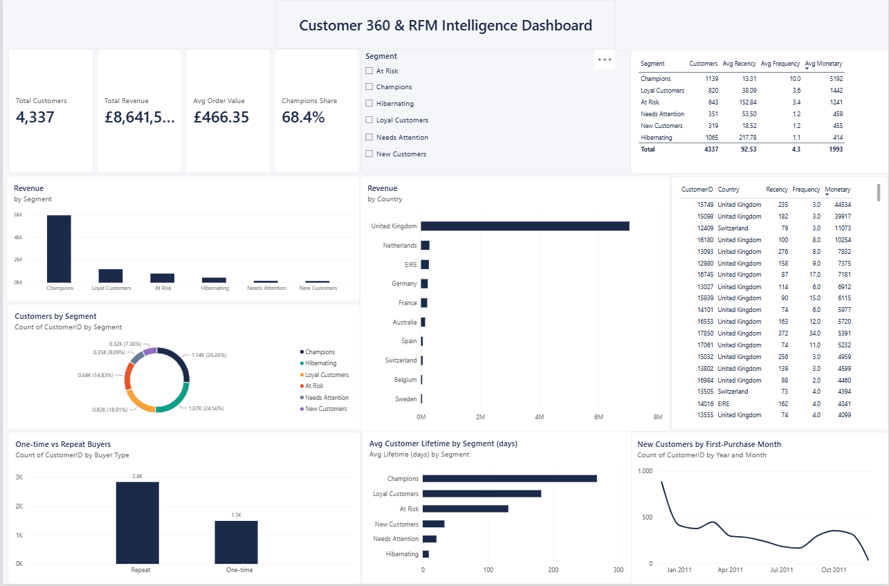
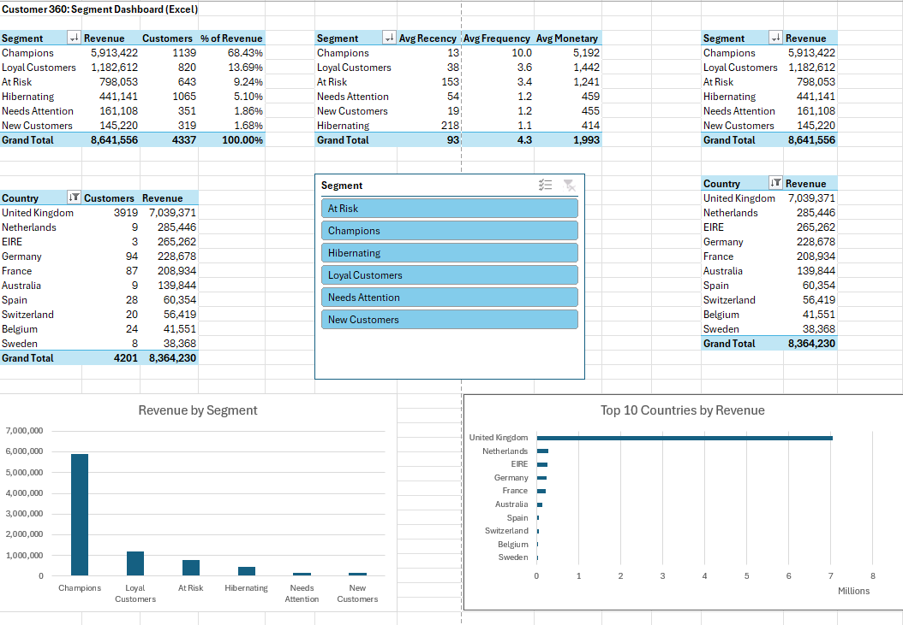

# Customer 360 & RFM Intelligence Platform

An end-to-end customer analytics project on a real online retail dataset. It segments 4,337 customers with RFM analysis, builds a single "Customer 360" table, and answers business questions in **Python (Pandas), Oracle SQL, Excel and Power BI**. The same results were checked across all four tools.

## Business problem

An online retailer treats every customer the same way. Which customers bring in the money, which ones are slipping away, and where should marketing focus first?

## Dataset

- **Source:** [Online Retail dataset, UCI Machine Learning Repository](https://archive.ics.uci.edu/dataset/352/online+retail)
- **What it is:** real transactions from a UK-based online gift retailer, December 2010 to December 2011
- **Size:** 541,909 raw rows, 392,690 rows after cleaning (missing customer IDs and returns removed), 4,337 customers

## Tools used

| Tool | Used for |
|---|---|
| Python (Pandas, Jupyter in VS Code) | Cleaning, RFM scoring, segmentation, Customer 360 table |
| Oracle SQL (SQL Developer, Oracle 10g) | 11 business queries (GROUP BY, HAVING, CASE, ROWNUM top-N, window function) |
| Excel | Pivot tables, charts and a segment slicer |
| Power BI | Interactive dashboard with cards, charts, tables and a segment slicer |

## Approach

1. **Cleaned** the raw transactions: removed rows with a missing CustomerID and returns (negative quantities).
2. **Calculated RFM** per customer: Recency (days since last purchase), Frequency (number of orders) and Monetary (total spend).
3. **Scored** each metric from 1 to 5 using quintiles, with Recency reversed so that a recent purchase scores high.
4. **Segmented** customers into Champions, Loyal Customers, New Customers, At Risk, Hibernating and Needs Attention.
5. **Built the Customer 360 table**: one row per customer with RFM, segment, country, first and last purchase, unique products, total items, average order value and customer lifetime in days.
6. **Analysed** the table in Oracle SQL, Excel and Power BI, and cross-checked the numbers between tools.

## Key findings

- **A quarter of customers bring over two-thirds of the revenue.** Champions are 1,139 customers (26% of the base) and generate about £5.91M of £8.64M total revenue (68%).
- **Champions behave very differently.** They last bought about 13 days ago on average, place about 10 orders and spend about £5,192 each, against about 218 days, 1.1 orders and £414 for Hibernating customers.
- **The business depends on its home market.** 3,919 of 4,337 customers (about 90%) are in the United Kingdom, including 1,036 of the 1,139 Champions.
- **About £1.24M of revenue sits with customers who may be lost.** At Risk (643 customers, £798K) and Hibernating (1,065 customers, £441K) together hold about 14% of revenue.
- **At Risk customers are the best win-back target.** They average about 3.4 orders and £1,241 each but last bought about 153 days ago. 244 At Risk customers have spent over £1,000.

## Suggested actions

- Protect Champions with early access and loyalty rewards.
- Contact high-spending At Risk customers first with a win-back offer (the win-back query in the SQL file lists them).
- Move Loyal Customers towards Champions with a loyalty incentive.
- Reduce dependence on the UK by testing marketing in the strongest overseas markets.

## Dashboards

### Power BI

### Excel

## Repository structure

| File | Description |
|---|---|
| `Customer_360_Real.ipynb` | Jupyter notebook: cleaning, RFM, segmentation, Customer 360 table |
| `customer_360.csv` | Final Customer 360 table (4,337 rows, 15 columns) |
| `rfm_scored.csv`, `rfm_segments.csv` | RFM scores and segments |
| `customer_360_queries.sql` | Oracle SQL queries, each with its business question |
| `customer_360.xlsx` | Excel workbook with pivot tables, charts and slicer |
| `customer_360_dashboard.pbix` | Power BI dashboard |
| `powerbi_dashboard.png`, `excel_dashboard.png` | Dashboard screenshots |

The cleaned and raw transaction files are not included because they are over GitHub's upload size limit. The notebook creates the cleaned file from the raw data.

## How to reproduce

1. Download the dataset from the UCI link above and save it in the same folder as the notebook.
2. Run `Customer_360_Real.ipynb` from top to bottom.
3. Load `customer_360.csv` into Oracle (SQL Developer import wizard) and run `customer_360_queries.sql`.
4. Open `customer_360.xlsx` and `customer_360_dashboard.pbix`.

## Limitations

- The data covers one retailer for about one year.
- Segments are rule-based on RFM scores, not a statistical model.
- The first month of the "new customers by month" chart includes customers who were already buying when the data starts, and the last month is partial (the data ends on 9 December 2011).

## Author

**Shazin TM**
[GitHub](https://github.com/Shazin-tm) | [LinkedIn](https://www.linkedin.com/in/shazin-tm)
